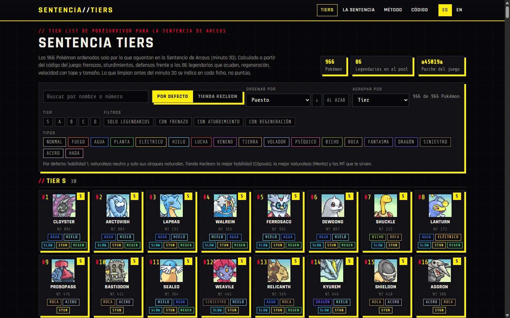
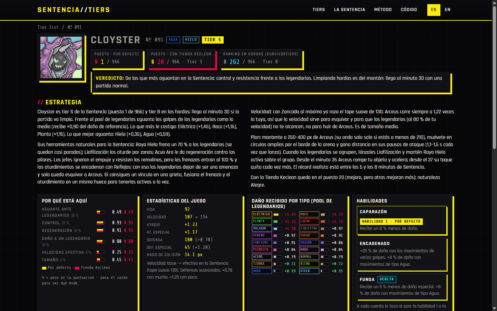

# Sentencia Tiers

[](https://juliolpzsu.github.io/sentencia-tiers/en/)
[](https://github.com/juliolpzsu/sentencia-tiers/actions/workflows/update.yml)
[](LICENSE)


A **PokéSurvivor** tier list for **Arceus' Judgment**: all 966 Pokémon ranked by how long they last after minute 30, with a page per Pokémon (build, abilities, items and strategy) in Spanish and English.

**→ https://juliolpzsu.github.io/sentencia-tiers/en/** · [README en español](README.md)



## Why

PokéSurvivor tier lists rank Pokémon by how they fare against the hordes. At minute 30 the game changes: Arceus descends into the arena, is invincible, outruns you, and every five seconds a stronger legendary shows up. What matters there is not damage (legendary HP scales with your own damage) but **slowing them, stunning them, surviving their hits and regenerating** Arceus' percentage damage. This site ranks by that.

Everything is computed from the **game's source code**, not from anyone's impressions: the Judgment rules, the softened type chart, defenses, abilities and moves are replicated as programmed.

## What the site offers

- **Tier list** of all 966 with search, sorting (rank, components, HP, speed…), grouping (tier, type, legendaries) and filters (type, tier, legendaries, has slow, has stun, has regeneration).
- Two switchable variants: **Default** (ability 1, neutral nature, natural moves) and **Kecleon Shop** (best ability via Capsule, best nature via Mint and the TMs that help).
- **Per-Pokémon page**: verdict, data-driven strategy, score breakdown, stats, damage taken by type against the real legendary pool, its three abilities with their exact in-game effect, and the build for each variant: four moves with the reasoning, starting move, bans, item, card priority and evolution conditions.
- **My save** (optional): paste your account's save and the site marks the Pokémon you own, their bought upgrades, the ability and nature you rolled, and your approximate rank with that ability. It stays in your browser; nothing is sent anywhere.
- **TMs on sale today**: the site computes the Kecleon Shop's 8 daily TMs with the game's own formula (checked against the real shop), shows how many builds use each and filters the Pokémon whose build asks for one of today's.
- Search also matches **moves** (from the build or learnable by TM) and **abilities**.
- A **Changes** page with the history of automatic updates.
- Filters, sorting and variant live in the **URL**, so any view can be shared as a link; every page carries a preview card for Discord, WhatsApp or X.
- **The Judgment** (the full mechanics, with numbers) and **Method** (weights, assumptions, legendary pool and credits) pages.
- *Night City* look, readable on phones and tablets, no dependencies or trackers.



## How it is computed

Six components normalized across the 966 and weighted:

| Component | Weight | What it measures |
|---|---|---|
| Toughness vs legendaries | 36% | Effective HP against the average damage of the 86-legendary pool (types, defenses, ability) |
| Control | 32% | Slows (land at 100% on bosses) and stuns (×0.35 but chainable) |
| Regeneration | 10% | The only thing that offsets Arceus' percentage damage |
| Damage to one legendary | 10% | Best ranged same-side attack |
| Effective speed | 8% | With the soft cap of 130 the Judgment imposes |
| Size | 4% | Collision radius: smaller is easier to dodge with |

Reaching minute 30 **does not score**: how good or bad a Pokémon is at clearing hordes is shown on its page (SurvivorTiers rank) and in the verdict. The full detail, with the formulas and the game files each rule comes from, is in [MODELO.md](MODELO.md) (Spanish).

## Repository layout

```
.
├── build/
│   ├── gamedata.py        Loads and parses the game data (data/game)
│   ├── abilfx.py          Ability descriptions as the game shows them
│   ├── rank.py            The model: computes data/ranking.json (the guide)
│   ├── gen.py             Generates the static site (docs/) in ES and EN
│   ├── fetch_portraits.py Downloads the portraits (PMD SpriteCollab)
│   └── update.py          Checks whether the game changed and updates if the ranking changes
├── data/
│   ├── game/              Verbatim copy of the game data + VERSION and RULES.sha
│   ├── ranking.json       The guide: rank, tier, components and builds for every Pokémon
│   └── CHANGELOG.md       History of automatic updates
├── docs/                  The site published with GitHub Pages (generated, do not edit by hand)
├── assets/readme/         Screenshots for the README
└── .github/workflows/     update.yml: daily automatic update
```

## Reproduce or modify

Only **Python 3.12+** is required; there are no external dependencies.

```bash
python -I build/rank.py             # recompute data/ranking.json
python -I build/gen.py              # regenerate docs/
python -I build/fetch_portraits.py  # only if portraits are missing
python -I build/update.py           # fetch game data and update if the ranking changes
```

To preview locally: `python -m http.server 8000 -d docs` and open `http://localhost:8000/en/`.

Tests (data, ranking, builds and determinism): `python -I -m unittest discover -s tests -v`. They run on every push (`tests.yml`) and before an automatic update is published.

Weights live in `W` inside `build/rank.py`; build logic in `choose_build`; site texts in the `UI` and `ITEMS` dictionaries and the `reason`, `cards_text`, `strategy` and `verdict` functions of `build/gen.py`.

## Automatic update

A GitHub Action runs daily at 06:30 UTC (and manually from the *Actions* tab, with the `force` option): it downloads the game's data files and the SurvivorTiers index; if anything changed it records the game commit in `data/game/VERSION` and recomputes the ranking; if the ranking changes it regenerates the site, writes `data/CHANGELOG.md` and commits as `sentencia-tiers[bot]`. If any of the **rule** files the model replicates by hand changed, the entry is flagged **REVISAR REGLAS** and `rank.py` must be reviewed manually.

## Contributing

Data, text and model fixes are welcome: see [CONTRIBUTING.md](CONTRIBUTING.md). For a mistake on a Pokémon page, open an issue with the *Error en una ficha* template.

## Credits and licence

- **PokéSurvivor** is by [JPTER78](https://github.com/JPTER78/pokesurvivor) (code under PolyForm Noncommercial 1.0.0). `data/game/` is a copy of its repository.
- The horde ranking shown on each page is by [SurvivorTiers](https://survivortiers.pages.dev/) (@fildotai).
- Portraits from [PMD SpriteCollab](https://github.com/PMDCollab/SpriteCollab), CC BY-NC 4.0 (per-artist credits in their repository).
- Pokémon © Nintendo / Creatures / GAME FREAK.

The code in this repository (`build/`, `docs/assets/`) is [MIT](LICENSE). Game data, portraits and names belong to their owners and are used in a non-profit fan project unaffiliated with the game's authors or Nintendo.
