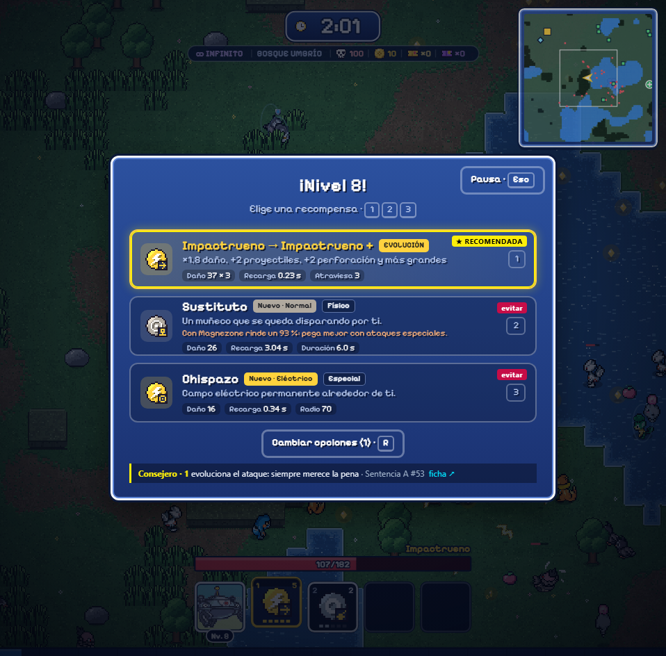

# Sentencia Tiers · Consejero

Extensión de navegador para [PokéSurvivor](https://pokesurvivor.com/). En cada subida de nivel marca qué carta coger (ataque nuevo, mejora de un ataque o mejora de stat) según la build de la Sentencia de Arceus del Pokémon que juegas, la misma que enseña su ficha en [Sentencia Tiers](https://juliolpzsu.github.io/sentencia-tiers/).

## Qué hace

- **★ RECOMENDADA** en la mejor carta, **también vale** en las que se quedan cerca y **evitar** en las que estropean la build. Debajo de las cartas, una línea con el motivo, el tier y el puesto del Pokémon y un enlace a su ficha.
- **Ataques nuevos:** los de la build primero, en el orden en que juegan los que más aguantan: el grupo que farmea (ataque principal, su potenciador y los otros ataques del primer hueco), después Ataque Rápido para el segundo hueco y el control (frenazo, aturdimiento, Acua Aro) al final. Uno fuera de la build solo se recomienda si te sobran huecos después de contar los que aún pide la build; si no, «evitar».
- **Mejoras de ataques:** las de la build, con el grupo que farmea por delante. Un punto más si con esa mejora llega al máximo y ya tienes la stat que pide su evolución.
- **Stats:** la carta dorada que desbloquea una evolución va primero, y también la stat que pida un ataque de la build cuando le faltan dos niveles o menos para el máximo. Después Reflejos, Carrera, Coraza, Vigor y Síntesis, valoradas por lo que **de verdad suman en tu partida**:
  - **Coraza** hace `min(70 %, actual + 6 %)`. Con reducción de Mejoras o el Chaleco Asalto llegas al 70 % antes de las 12 cartas, y las que sobran no suman nada aunque el juego las siga ofreciendo: el Consejero lo detecta.
  - **Carrera** se cuenta con tu velocidad real (Mejoras y objeto incluidos) hasta el tope suave de 130 de la Sentencia.
  - **Reflejos** deja de servir si tus ataques ya están en la recarga mínima (0,12 s).
  - El motivo enseña cuántas llevas de cada una y su tope (por ejemplo «(3/10)»): al llegar al tope, el juego deja de ofrecerla. La Baya Zidra sube mucho con poca vida (por debajo del 40 %). Potencia y Aprendizaje valen más al principio de la partida (hordas) que al final.
- **Evoluciones:** siempre recomendadas.
- Si las tres cartas estropean la build (ataques que ocupan un hueco que pide otro), marca la menos mala y, si te quedan cambios, sugiere cambiar las cartas. Si hay una carta inofensiva (Imán, Baya Zidra…), la recomienda antes que gastar un cambio.
- Con la **Tienda Kecleon**: si ya has enseñado las MT de su build de tienda, usa esa build en vez de la base.
- **Objeto** («Quedarme con» o «Cambiar a»): recomienda según los tres objetos de la build de la web, en su orden; el resto va por lo que ayuda a aguantar (la Cinta Elección, la última: no deja cambiar de ataque y rompe la rotación del control). Recuerda que en la Sentencia Arceus rompe tu objeto en el minuto 35.
- **Vínculo** (tras ganar la pelea de una grieta): qué ataques fusionar en un mismo hueco: el grupo del primer hueco de la web (salen a la vez y el potenciador solo funciona activo); Ataque Rápido nunca, va aparte para esquivar. Con el grupo completo, la web aconseja no entrar en más grietas: fusionar libera huecos y vuelven a salir ataques nuevos en vez de mejoras.
- **Grietas**: cuando se abre una y ya tienes fusionado en un solo hueco el grupo del primer hueco de la build, un aviso rojo sobre la barra de vida te dice que no entres.
- **Letra de la Sentencia en la cuadrícula** (pantalla Pokémon): cada casilla lleva abajo a la izquierda el tier del Pokémon en la Sentencia (S a D, en amarillo; el puesto, al pasar el ratón), con una nota bajo la cuadrícula. Convive con las letras de SurvivorTiers de PokeSurvivor Plus, que miden las hordas y van abajo a la derecha.
- **Ficha del Pokémon** (pantalla Pokémon del menú): un bloque con su tier y puesto en la Sentencia, la build, los ataques que conviene **vetar** y el orden de objetos, con enlace a la ficha de la web.
- **Durante la Sentencia**: una línea sobre la barra de vida con la distancia a Arceus por zonas (a menos de 210 px lanza su onda; la web aconseja 250–400 px), cuántos legendarios tienes encima y, si son dos o más, que actives Ataque Rápido (invulnerable 0,3 s por embestida frente a ellos) o, si no lo llevas, el frenazo o el aturdimiento de tu build, con su tecla. No dibuja sobre el juego: es una capa aparte que no tapa las flechas ni el minimapa de PokeSurvivor Plus.
- **Alt + J** enciende y apaga el Consejero.

## Convivencia con PokeSurvivor Plus

Está hecha para funcionar junto a PokeSurvivor Plus, en cualquier orden de carga:

- Las dos necesitan el objeto interno del juego. Si PokeSurvivor Plus ya lo ha cogido (`window.__psmodNS`), el Consejero usa ese; si no, lo atrapa con el mismo método **encadenado** con la trampa que hubiera, sin quitársela a nadie.
- Solo envuelve `LevelUp.offer` (devuelve la misma lista), el `apply` de cada carta para anotar cuál eliges y `RunUI.showItemChoice` / `RunUI.showBond` para saber qué se ofrece, llamando siempre al original. No reescribe las cartas ni cambia lo que hace elegir una: añade una etiqueta dentro de cada carta (PokeSurvivor Plus les fija el alto) y una línea al final de la caja. Funciona también con el cambio de carta en cooperativo de PokeSurvivor Plus.
- Todo lo suyo lleva el prefijo `sta-` (clases, ids, `localStorage`). Atajo Alt + J, que PokeSurvivor Plus no usa.

## Registro de partidas

Para ajustar los pesos con partidas reales, el Consejero anota en este navegador (`localStorage`, clave `sta:runs`, las últimas 30 partidas) qué cartas salieron, cuál recomendó y cuál elegiste, y al acabar la duración, el nivel y los segundos de Sentencia. Las partidas del modo Infinito de PokeSurvivor Plus quedan marcadas. No se envía a ningún sitio. Se puede ver o borrar desde la consola: `__stAdvisorApi.runs()` y `__stAdvisorApi.clearRuns()`.

## Datos

`data.js` es una copia de los datos de la web que se genera con `python -I build/gen.py` (ver `build/advisor.py`). Una vez al día la extensión baja `assets/advisor.json` de la web, que la Action diaria regenera cuando cambia el ranking; si la web no responde, usa la copia de serie.

## Instalar (Chrome, Edge, Brave, Opera)

Desde la **[Chrome Web Store](https://chromewebstore.google.com/detail/glehijclpafhcajjdcmmcaepkjeianlo)**: «Añadir a Chrome» y recarga pokesurvivor.com. Se actualiza sola.

Para probar la versión del repositorio (puede ir por delante de la tienda):

1. Abre `chrome://extensions` y activa el **Modo de desarrollador**.
2. **Cargar descomprimida** y elige esta carpeta (`extension/`).
3. Recarga pokesurvivor.com.

## Privacidad

El Consejero no recoge, guarda en servidores ni envía ningún dato del jugador. Lee las cartas de subida de nivel dentro de la propia página del juego para marcarlas, y solo hace una petición de red: una vez al día descarga el fichero público `https://juliolpzsu.github.io/sentencia-tiers/assets/advisor.json` (sin cookies ni identificadores). En el `localStorage` del navegador guarda únicamente esa copia de los datos, si está encendido o apagado y el registro local de tus últimas partidas (claves `sta:`), que nunca sale de tu navegador. No usa analítica ni publicidad.

*Privacy: the Advisor collects, stores remotely or sends no player data. It reads the level-up cards inside the game page to mark them, and its only network request is a daily download of the public `advisor.json` file above (no cookies or identifiers). It keeps only that data copy, its on/off switch and a local log of your last runs in the browser's `localStorage` (`sta:` keys), which never leaves your browser. No analytics, no ads.*

## Limitaciones

- Recomienda para la **Sentencia** (el criterio de la web), no para hordas: antes del minuto 30 da algo más de peso a Potencia y Aprendizaje, pero nada más.
- No conoce tu objeto, tu habilidad ni tu naturaleza; trabaja con la build general del Pokémon.
- El juego cambia casi a diario. Si deja de exponer lo que el Consejero necesita, simplemente no marca nada.

---

## In English

Browser extension for PokéSurvivor: on every level-up (and on item and bond choices) it marks which card to take (new move, move upgrade or stat) according to the Arceus Judgment build of the Pokémon you play, the one shown on its [Sentencia Tiers](https://juliolpzsu.github.io/sentencia-tiers/en/) page. Build moves first (slow and stun ahead), off-build moves only when there are spare slots, evolution cards always, then Reflexes, Sprint up to the speed soft cap, Armor, Vigor and Synthesis; Sitrus Berry when HP is low. During the Judgment it shows your distance to Arceus, nearby legendaries and which control move to switch to. When a rift opens and the slot-1 group is already fused, it warns you to skip it. It also adds the Judgment build, vetoes and item order to the in-game Pokémon page, and a yellow Judgment tier letter on every cell of the Pokémon grid (bottom left; PokeSurvivor Plus’s SurvivorTiers letters, which rank hordes, stay bottom right). Alt + J toggles it. Built to run alongside PokeSurvivor Plus in any load order: it reuses its hook into the game when present, chains its own otherwise, only wraps `LevelUp.offer` (returning the same list) and adds a tag to each card plus one line under them. Install it from the **[Chrome Web Store](https://chromewebstore.google.com/detail/glehijclpafhcajjdcmmcaepkjeianlo)**, or with **Load unpacked** on `chrome://extensions` (Developer mode) pointing at this folder.
